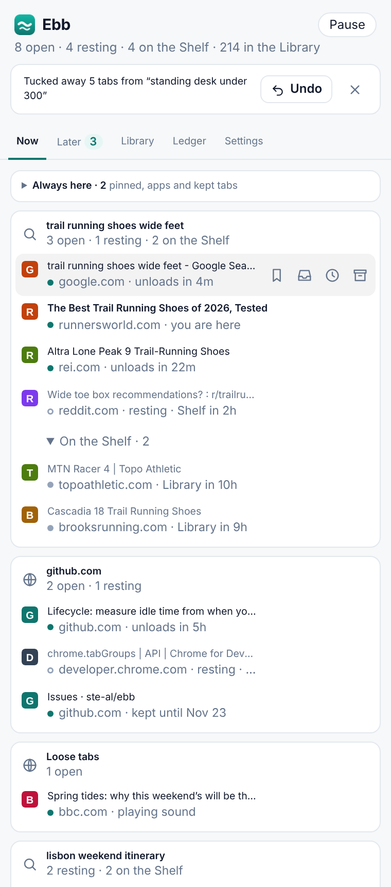
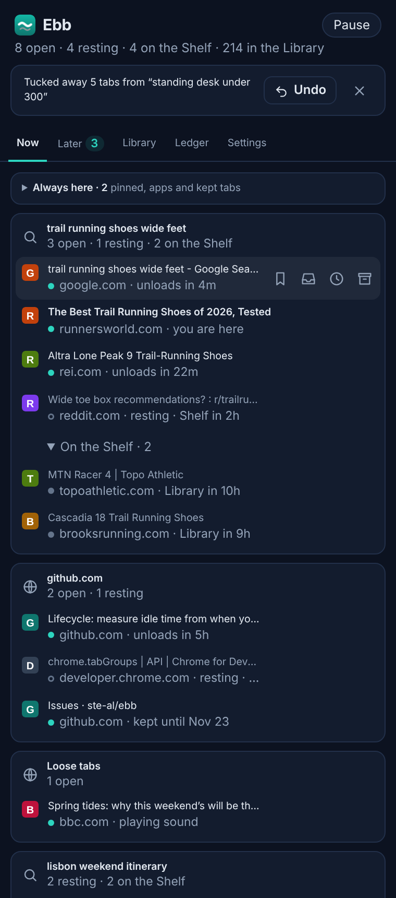
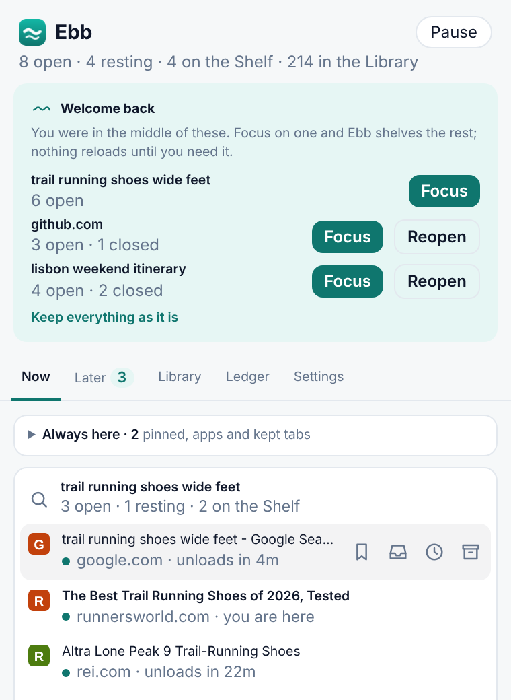
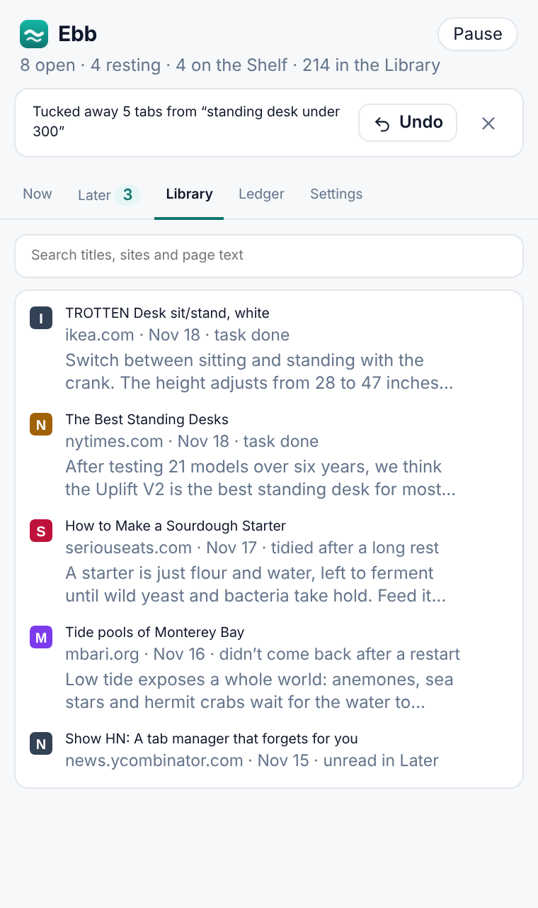
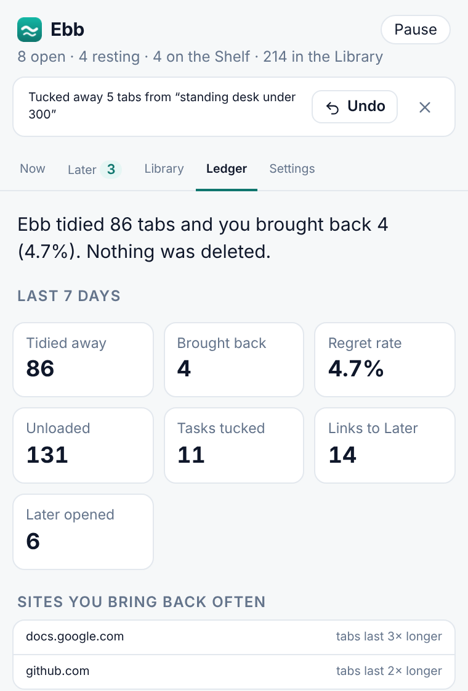

<p align="center"></p>

<h1 align="center">Ebb</h1>

<p align="center"><b>Calm tabs for people who keep too many.</b><br>
Tabs you leave alone quietly ebb away: unloaded, then shelved, then saved to a searchable Library.<br>
Nothing is lost, and there is nothing to organize.</p>

<p align="center">
  
  &nbsp;
  
</p>
<p align="center"><sub>The side panel, with example data.</sub></p>

---

Most tab tools ask you to do the work: save sessions, sort groups, decide what to close. Ebb takes the opposite approach. It watches which tabs you actually use and lets the rest drift out of the way in reversible stages, at moments when you won't notice, and it keeps your place on every page so that coming back is one click.

**Status:** v0.1 for Chrome 116+ (Manifest V3). Other Chromium browsers may work but are untested. Not on the Chrome Web Store yet; install it from source (below).

## What it does

**Tabs ebb in stages.** A tab you leave alone is first **resting**: unloaded in place, still in your tab bar, reloaded when clicked. Later it moves onto the **Shelf**, a collapsed tab group at the end of the tab bar. Much later it closes into Ebb's **Library**, with its scroll position, media time and a snippet of its text.

**Only active time counts.** Lifetimes are measured in time you actually spend using Chrome (window focused, you at the keyboard), so a weekend away doesn't empty your tabs.

**Lifetimes adapt.** Tabs you come back to live longer: a tab you opened once rests after 30 active minutes, one you returned to after 2 hours, and one you keep returning to after 6 hours. Search results, news and social posts fade twice as fast; documents and references last twice as long. Sites you often bring back automatically get 2–3× longer lifetimes. Pick a pace: gentle, balanced or brisk.

**Moves happen at natural boundaries.** Unloading can happen any time, since nothing visibly moves. Shelving and archiving wait until you step away or switch to another app, and happen at most 25 tabs at a time.

**Tasks, not piles ("hunts").** Ebb groups tabs by what you were doing, with no manual grouping. A search starts a task named by its query (refining the query keeps the same task), tabs opened from it join it, and typing an address starts a task named by its site.

**Mission accomplished.** When a page says you're done (an order, booking, payment or application confirmation), Ebb offers to tuck that task's other tabs into the Library. It keeps a receipt of the confirmation page, and Undo brings everything back. Ebb only offers; it never does this on its own.

**A Later lane.** When one page spawns a pile of background tabs (more than 4 within 5 minutes by default), the extra links go to a Later list instead of your tab bar. You get a small note on the page with an *Open now* button. You can also right-click any link and choose *Save link to Later*. Unread links move to the Library after two weeks.

**Resume, don't restore.** After a browser restart, Ebb recognizes your restored tabs and keeps their tasks. Tabs that were unloaded stay unloaded instead of all loading at once. Tabs that didn't come back are saved to the Library. A *Welcome back* card lets you focus on one task (shelving the rest) or reopen one.

**A regret ledger.** Ebb counts every tab it tidies and every one you bring back, and shows you the rate: *"Ebb tidied 86 tabs and you brought back 4 (4.7%)."*

<p align="center">
  
  
  
</p>

### What Ebb never touches

- The tab you're on, in every window
- Pinned tabs and tabs playing sound
- Tabs with unsaved typing. Ebb notices that a text field you typed in isn't empty; it never reads what you typed, and ignores password and search fields.
- Web apps you keep open: mail, calendar, chat and the like
- Tabs you keep (for a week, or always), and sites you list as never tidy
- Tabs in your own tab groups are only unloaded, never moved (this can be turned off)

## Install

1. Get the code: `git clone https://github.com/ste-al/ebb.git` (or download the ZIP and unpack it).
2. Open `chrome://extensions` and turn on **Developer mode**.
3. Click **Load unpacked** and choose the `extension` folder.
4. Pin Ebb from the puzzle-piece menu. Click its icon (or press <kbd>Alt</kbd>+<kbd>Shift</kbd>+<kbd>E</kbd>) to open the side panel.

A welcome page explains the stages and lets you pick a pace. To update, pull the latest code and click the reload icon on Ebb's card in `chrome://extensions`.

## Using it

There's nothing you have to do. When you want to look:

- **Now** shows each window's tabs by task, with what happens to each tab next ("unloads in 12m", "Shelf in 3h"). Hover a tab to keep it, shelve it, send it to Later or close it into the Library. Click a task's ✓ to tuck the whole task away.
- **Later** holds queued links. Click one to open it.
- **Library** is searchable by title, address, task and page text. Click an item to bring it back. Recently closed tabs return with their back/forward history.
- **Ledger** shows the week's numbers, plus the sites Ebb now keeps longer because you bring them back.
- **Settings** has the pace, the visible-tab budget, the Later lane, privacy options, a *Fresh start* (move everything unprotected to the Library as one undoable batch) and export/import.

| Shortcut | What it does |
| --- | --- |
| <kbd>Alt</kbd>+<kbd>Shift</kbd>+<kbd>E</kbd> | Open Ebb |
| <kbd>Alt</kbd>+<kbd>Shift</kbd>+<kbd>K</kbd> | Keep this tab for a week (press again to stop) |
| <kbd>Alt</kbd>+<kbd>Shift</kbd>+<kbd>L</kbd> | Send this tab to Later |

You can change these at `chrome://extensions/shortcuts`. Right-click menus offer *Save link to Later*, *Send this tab to Later* and *Keep this tab for a week*.

### Defaults

| Setting | Default |
| --- | --- |
| Pace | Balanced: a tab you opened once rests after 30 active minutes, moves to the Shelf after 3 hours and to the Library after 24 hours of active time |
| Visible tabs per window | 15. Above this, the least recently used tabs move to the Shelf while you're away. Never in the first active hour after install, and never tabs used in the last 20 minutes. |
| Shelf | On. A tab stays on it at least an active hour before going to the Library. |
| Later lane | Queue extras when one page opens more than 4 background tabs in 5 minutes; unread links move to the Library after 14 days |
| Tuck-away offers | On |
| Leave my tab groups alone | On |
| Text snippets | On (about 600 characters per tidied page, for search) |

## Privacy

Ebb makes no network requests and has no analytics. Everything it keeps (tab records, the Library, Later, the ledger) stays in the extension's local storage on this device, and is removed when you uninstall it. Text snippets can be turned off in Settings. Export/import gives you all your data as a JSON file.

| Permission | Why Ebb needs it |
| --- | --- |
| `tabs`, `tabGroups` | See your tabs, unload them, and keep the Shelf group |
| `idle`, `alarms` | Count active time and notice when you step away |
| `webNavigation` | Recognize searches and new tasks, and links opened in the background |
| `sessions` | Bring recently closed tabs back with their history |
| Access to `http`/`https` pages, `scripting` | The small content script that saves your scroll position and a text snippet, notices unsaved typing, and shows Ebb's notes on the page. `scripting` adds it to tabs that were already open when Ebb was installed. |
| `storage`, `unlimitedStorage` | Keep state and the Library on this device |
| `sidePanel`, `contextMenus`, `favicon` | The panel, the right-click items, and site icons from Chrome's own cache |

## Known limitations

- When Ebb closes a tab (to the Library, to Later, or when tucking a task away), Chrome lists it under *Recently closed* like any closed tab, so <kbd>Ctrl</kbd>+<kbd>Shift</kbd>+<kbd>T</kbd> may reopen a tab Ebb tidied rather than the one you just closed. This is one reason Ebb only moves tabs while you're away.
- After a restart, tabs are matched to Ebb's records by address. A page that redirects as it loads may not be recognized, and its old record is saved to the Library instead.
- Scroll restore is best effort. Pages that render late or use virtual scrolling may not land exactly where you were.
- Confirmation pages are recognized by heuristics in English, Czech, German, French and Spanish.
- The content script can't run on some pages (the Chrome Web Store, the PDF viewer, other extensions' pages). Those tabs are still tidied, just without scroll position or snippet.
- Chrome only for now. A Firefox version would need a different design for the Shelf and the panel.

## Development

```sh
npm install
npm test            # unit tests and engine scenarios (Node 20+, no browser needed)
npm run test:e2e    # the real extension in Chrome for Testing
npm run check       # every file the manifest and pages refer to exists, scripts parse
npm run pack        # dist/ebb-<version>.zip for the Chrome Web Store
npm run icons       # redraw the icons (Python 3 + Pillow)
node scripts/screenshots.js   # regenerate the README screenshots (example data)
```

The end-to-end test needs [Chrome for Testing](https://developer.chrome.com/blog/chrome-for-testing), because branded Chrome no longer loads unpacked extensions from the command line. Install it with `npx @puppeteer/browsers install chrome@stable` and point `CHROME_PATH` at the binary it prints (the default is `/usr/bin/google-chrome`).

```
extension/
  manifest.json
  background.js          service worker: wires events, menus, shortcuts and messages to the engine
  lib/engine.js          all behavior, written against small "ports" so it runs on fakes in tests
  lib/*.js               pure rules: lifetimes, hunts, missions, the Later lane, the ledger, settings
  lib/chrome-ports.js    the ports backed by Chrome APIs; lib/idb.js is the IndexedDB store
  content/content.js     the content script
  sidepanel/  welcome/   the panel and the welcome page (plain HTML, CSS and JS, no build step)
test/
  unit/                  the pure rules
  engine/                scenarios against a fake browser that mimics Chrome's tab semantics
  e2e/                   a tour of the real extension in Chrome for Testing
docs/DESIGN.md           how it works, and why
```

There is no build step and there are no runtime dependencies: the `extension` folder is what Chrome loads.
